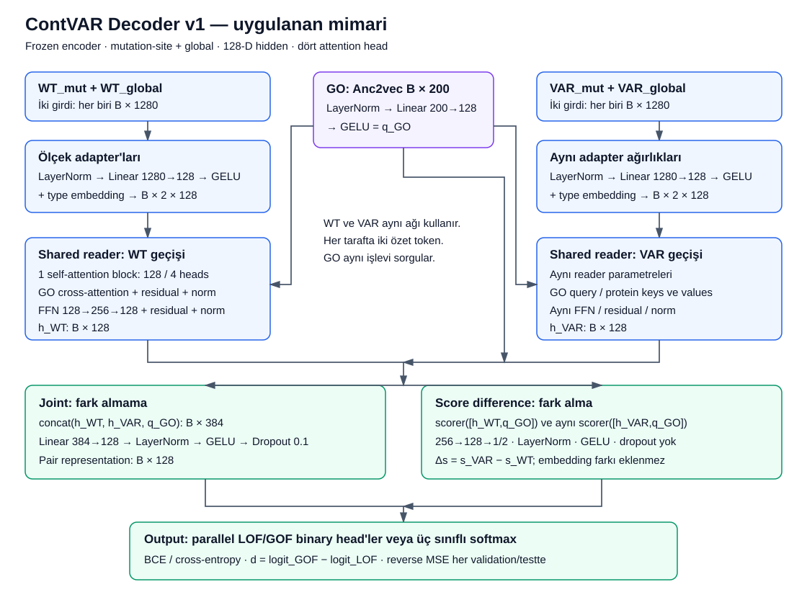

# Uygulanan decoder mimarisi

Bu belge teslim edilen `contvar_decoder/model.py` uygulamasını tarif eder. Encoder ekiplerinden gelen frozen cache sabittir; aşağıdaki adapter/attention/fusion/head parametreleri sıfırdan öğrenilir. Görev, `(WT, tek aminoasit varyantı, sorgulanan GO)` için LOF/GOF/NEUTRAL tahminidir.

PyTorch'un ürettiği bütün katman ağacı [layer_dump.txt](layer_dump.txt), makine tarafından okunabilir konfigürasyonlar ve parametre sayıları [model_specs.json](../metadata/model_specs.json) içindedir.



## Girdi sözleşmesi

Batch boyutu B:

| Girdi | Boyut | Anlamı |
|---|---|---|
| WT_mut / VAR_mut | Her biri B×1280 | Mutasyon pozisyonunun contextual residue vektörü |
| WT_global / VAR_global | Her biri B×1280 | İşlenen ilk en çok 1022 residue'nun mean-pool özeti |
| GO | B×200 | `matched_go_id` ile alınan sabit Anc2vec |

`local.h5`, mutation-site dosyasıdır; sekans penceresi içermez. Şu an her protein tarafında iki token vardır. GO reader residue seçimi değil, mutation-site/global ölçek seçimi yapar. Global summary uzun proteinlerin tamamını kapsamayabilir.

## Katmanlar ve boyutlar

| Blok | Gerçek katmanlar | Çıktı |
|---|---|---|
| Mutation-site adapter | LayerNorm(1280) → Linear(1280,128) → GELU | B×128 |
| Global adapter | Ayrı LayerNorm(1280) → Linear(1280,128) → GELU | B×128 |
| Token kimliği | Öğrenilebilir 2×128 type embedding eklenir | Her tarafta B×2×128 |
| GO adapter | LayerNorm(200) → Linear(200,128) → GELU | q_GO: B×128 |
| Memory contextualizer | Bir TransformerEncoderLayer: d_model=128, nhead=4, FFN=256, GELU, norm_first=True, dropout=0 | B×2×128 |
| GO cross-attention | MultiheadAttention(128,4), query=q_GO, key/value=memory, dropout=0 | B×1×128 |
| Cross-attention residual | LayerNorm(q_GO + attention_output) | B×1×128 |
| Reader FFN | Linear(128,256) → GELU → Linear(256,128) | B×1×128 |
| Reader residual | LayerNorm(h + FFN(h)); tek query boyutu kaldırılır | h_WT/h_VAR: B×128 |

Contextualizer içinde pre-norm self-attention, residual bağlantılar ve 128→256→128 FFN bulunur. WT/VAR için aynı ölçeğin adapter'ı ve reader'ın tamamı paylaşılır. Mutation-site ve global adapter'ları birbirinden farklıdır. Tek reader iki kez çağrılır; iki bağımsız WT/VAR ağı eğitilmez. Dört attention head'in her birinde head boyutu 32'dir; final prediction head sayısından farklı bir kavramdır.

## Joint: fark almayan seçenek

```text
x = concat(h_WT, h_VAR, q_GO)              # B×384
h = Linear(384,128) → LayerNorm(128)
    → GELU → Dropout(0.1)                 # B×128
```

Üç sınıflı output: `Linear(128,3)` ve softmax. Cross-entropy eğitimde ham logitleri alır; softmax loss'tan önce ayrıca uygulanmaz.

Paralel output: iki bağımsız `Linear(128,1)` ile LOF ve GOF logitleri. İki binary hedef kaynak `parallel` tablosundan okunur; sigmoid/BCEWithLogits kullanılır. NEUTRAL örneği hedef `(0,0)` alır. Tahminde her head için eşik 0.5; yalnız biri pozitifse o sınıf, ikisi de negatifse NEUTRAL, ikisi de pozitifse daha büyük head skoru seçilir. Çakışma oranı raporlanır. Nötr yardımcı skoru `1−max(p_LOF,p_GOF)`; üç skorun toplamı 1 olmak zorunda değildir.

## Score difference: fark alan seçenek

```text
s_WT  = scorer(concat(h_WT, q_GO))         # 256→128→1 veya 2
s_VAR = aynı_scorer(concat(h_VAR, q_GO))
Δs = s_VAR − s_WT
```

Scorer: Linear(256,128) → LayerNorm(128) → GELU → Linear(128,1/2). Çıkarma embeddingler arasında yapılmaz. WT skoru diğer taraftaki varyanta bağlı değildir. Bu yolun tamamında dropout=0; aynı girdi aynı skoru üretir.

Üç sınıflı model tek scalar skor kullanır:

```text
ℓ_LOF = −Δs
ℓ_GOF = +Δs
ℓ_NEUTRAL = b − softplus(a)·|Δs|
```

`b` ve `a` öğrenilir; logitlere softmax/CE uygulanır. Bu, sıfır çevresinde nötr bölge öğrenen bir başlangıç tasarımıdır; toplantı notlarından zorunlu olarak çıkmış tek head formülü değildir.

Paralel modelde scorer iki çıktı verir:

```text
Δs_LOF = f_LOF(VAR,GO) − f_LOF(WT,GO)
Δs_GOF = f_GOF(VAR,GO) − f_GOF(WT,GO)
ℓ_LOF = −Δs_LOF − softplus(radius)
ℓ_GOF = +Δs_GOF − softplus(radius)
```

İki scorer çıktısı farklıdır; reader/hidden trunk paylaşılır. Ortak radius yön kontrastının simetrisini korur. Ayrı sigmoid ve BCE kullanılır.

## Parametreler

| Kombinasyon | Eğitilen parametre |
|---|---:|
| Paralel + fark | 657.811 |
| Paralel + joint | 674.194 |
| Üç sınıflı + fark | 657.683 |
| Üç sınıflı + joint | 674.323 |

İki ölçek adapter'ı 333.056, GO adapter'ı 26.128, shared reader 264.960, type embedding'ler 256 parametredir. Joint fusion 49.536 parametre ekler. Bu sayılar ESM-2 encoder'ını içermez. Model aileleri benzer büyüklüktedir ama aynı karar ailesi değildir; bir skor farkına indirgeme ayrıca bir kısıttır.

## Reverse metriği ve loss

Her aile için yönlü tanım `d = ℓ_GOF−ℓ_LOF`:

```text
d_forward = d(WT,VAR,GO)
d_reverse = d(VAR,WT,GO)
L_reverse = mean((d_forward + d_reverse)^2)
L_total = L_classification + λ·L_reverse
```

Validation/testte lambda'dan bağımsız hesaplanır. Joint modellerde lambda 0/0.1 kontrollü karşılaştırılır. Reverse penalty hesaplanırken dropout kapatılır fakat gradient korunur. Normal joint classification pass'inde fusion dropout'u açıktır. Ters örnek için otomatik ters etiket oluşturulmaz.

Skor farkı modellerinde seçilen head eşlemeleriyle d antisymmetriktir; lambda kontrolü yeni bir eğitim sinyali vermez. Sayısal hata mertebesinde küçük değerler beklenebilir. Suite bu gereksiz ikinci eğitimi yapmaz. Sıfır d üreten bilgisiz model de bu metriği sağlar; Macro-F1, sınıf sonuçları ve d RMS birlikte okunur. Ek olarak sınıf değiştirme hatası ve `p_GOF−p_LOF` yön tutarlılığı raporlanır. Bağımsız paralel head'lerde d simetrisi tüm sigmoid skorlarının yer değiştirmesini garanti etmez.

## Eğitim ayarları

AdamW, lr=3e−4, weight_decay=1e−4; batch=128; en fazla 20 epoch; iyileşme olmadan 5 epoch sonra early stopping; gradient norm clip=5; seed=42. Ana deneyde sınıf ağırlıkları kapalıdır. Veri normalizasyonu öğrenilebilir, örnek içi LayerNorm ile yapılır; validation/test üzerinden global istatistik fit edilmez. Encoder ve GO kaynak vektörleri sabittir. H5 verisi yalnız okuma modunda açılır; tekrar I/O maliyetini düşürmek için benzersiz vektörler CPU belleğine alınır.

## Proposal ile eşleşme ve henüz olmayanlar

Proposal §4.4'teki ortak boyuta projection, scale type embedding, paylaşılan WT/VAR self-attention ve GO cross-attention, küçük concat fusion ve üç sınıflı output uygulanmıştır. Paralel ve scalar fark output'ları toplantı kombinasyonları için eklenmiştir. Bu sürüm PyTorch ile sıfırdan initialize edilir; pretrained STAR-GO checkpoint'i değildir.

Ayrı comparison reader, DELTA/LOCAL_PAIR memory, residue-aligned local comparison, pocket, auxiliary FiLM ve encoder LoRA bu sürümde yoktur. Yeni pooled ölçekler adapter + type + availability mask ile eklenebilir. Yeni scale/encoder sürümü yeni eğitim ve validation gerektirir. Attention ağırlıkları fiziksel veya nedensel kanıt olarak yorumlanmaz; skorlar ölçülmüş aktivite değildir ve ayrıca kalibre edilmemiştir.
