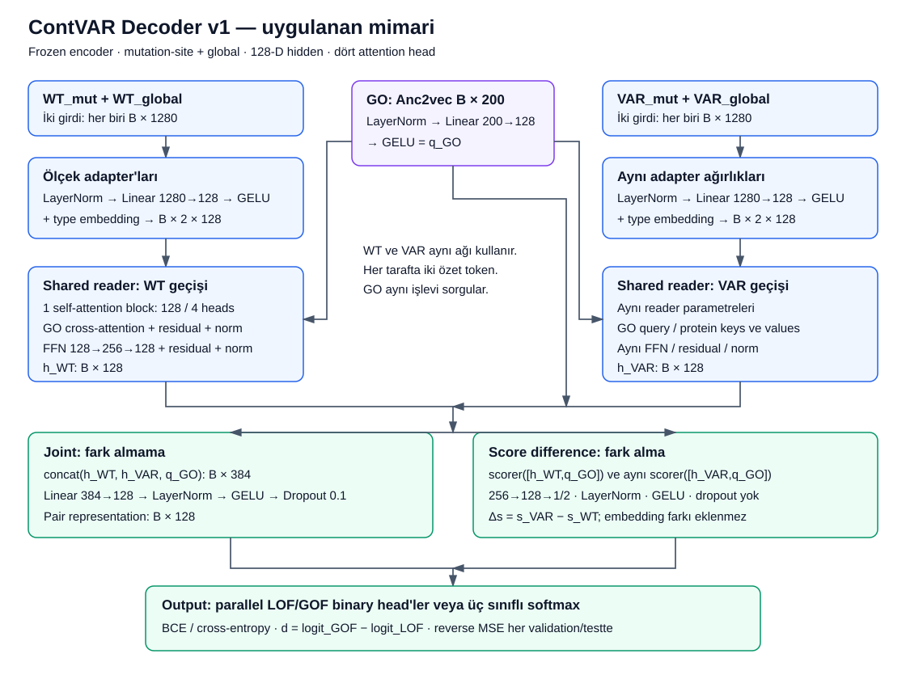

# Implemented architecture

The implementation is a randomly initialized GO-conditioned decoder over
frozen features. The two-scale baseline preserves the equations and checkpoint
state names of the standalone seed-42 implementation.



## Inputs and shared reader

For batch size B, each side receives `mut:[B,1280]` and `global:[B,1280]`;
GO is `[B,200]`. `mut` is one contextual residue at the mutation position.
The global cache mean-pools the processed prefix of at most 1022 residues.
Neither vector is a residue window or a guaranteed full-length protein summary.

| Block | Layers | Output |
|---|---|---|
| Mutation adapter | LayerNorm(1280), Linear(1280,128), GELU | `[B,128]` |
| Global adapter | Separate LayerNorm(1280), Linear(1280,128), GELU | `[B,128]` |
| Scale identity | Learned `[2,128]` type embeddings | memory `[B,2,128]` |
| GO adapter | LayerNorm(200), Linear(200,128), GELU | query `[B,128]` |
| Memory contextualizer | One pre-norm TransformerEncoderLayer, 4 heads, 256-D FFN, GELU, dropout=0 | `[B,2,128]` |
| GO readout | MultiheadAttention(128,4), Q=GO, K/V=memory, dropout=0 | `[B,1,128]` |
| Attention residual | LayerNorm(query + readout) | `[B,1,128]` |
| Reader FFN | Linear(128,256), GELU, Linear(256,128) | `[B,1,128]` |
| FFN residual | LayerNorm(h + FFN(h)), squeeze query axis | `[B,128]` |

The contextualizer itself includes pre-norm self-attention/residual and a
128→256→128 FFN/residual. Each attention head has width 32. The same adapter
for a given scale and the entire reader are shared across WT and VAR; the
reader is called twice. Mutation/global adapters have different weights.

Attention currently selects among **two pooled scale tokens**, not residues:
per-head self-attention is 2×2 and GO cross-attention is 1×2. Attention weights
are not causal or experimental explanations.

`available:[B,S]` uses True for present scales. All-missing examples are rejected;
masked features cannot contribute to attention. Model-level support for more
pooled scales does not automatically extend the data loader or add a window
pooling/comparison implementation.

## Joint models

```text
concat(h_WT, h_VAR, q_GO) : [B,384]
Linear(384,128) → LayerNorm(128) → GELU → Dropout(0.1)
```

Multiclass uses `Linear(128,3)`, raw-logit cross entropy and output softmax.
Parallel uses separate `Linear(128,1)` LOF and GOF heads, raw-logit BCE and
independent output sigmoids. Native targets are LOF=(1,0), GOF=(0,1),
NEUTRAL=(0,0); all samples supervise both heads.

Parallel prediction preserves the fixed 0.5 rule: neither positive → NEUTRAL;
otherwise the stronger head wins. Tied positive heads select LOF by index order.
`score_neutral=1-max(p_LOF,p_GOF)` is an auxiliary decision score. These three
scores need not sum to one. Both heads can be positive; an abstain policy has
been discussed but is **not implemented**.

## Separate-score models

The same scorer independently processes each side:

```text
f = Linear(256,128) → LayerNorm(128) → GELU → Linear(128,K)
s_WT = f(concat(h_WT,q_GO))
s_VAR = f(concat(h_VAR,q_GO))
delta = s_VAR - s_WT
```

There is no dropout in this path. Scores are subtracted before sigmoid or
softmax; embeddings are not subtracted.

For multiclass, K=1:

```text
logit_LOF = -delta
logit_GOF = +delta
logit_NEUTRAL = b - softplus(a) * abs(delta)
```

`a,b` are learned. This scalar-to-class mapping is an explicit prototype choice,
not the only interpretation of the meeting's score-subtraction requirement.

For parallel, K=2 and `r=softplus(raw_radius)`:

```text
delta_LOF = f_LOF(VAR,GO) - f_LOF(WT,GO)
delta_GOF = f_GOF(VAR,GO) - f_GOF(WT,GO)
logit_LOF = -delta_LOF - r
logit_GOF = +delta_GOF - r
```

The two deltas differ. This is not one scalar neutral band shared by both
heads. A common radius preserves oddness of the signed logit contrast; it does
not guarantee mutual exclusion of the sigmoid scores.

## Reversal and parameters

`d=logit_GOF-logit_LOF`; the additional `direction_index` is the output-score
contrast. For forward and swapped WT/VAR inputs:

```text
L_reverse = mean((d_forward + d_reverse)^2)
L_total = L_classification + lambda_reverse * L_reverse
```

Reversal MSE/MAE are always evaluated. Joint regularization uses separate
deterministic forward/reverse passes with autograd enabled and restores the
training mode afterward. Normal joint classification retains fusion dropout.
No reverse class labels are invented.

Separate-score d is structurally odd: multiclass d=2*delta; parallel
d=delta_LOF+delta_GOF. Its extra lambda training would be redundant. A constant
d=0 model also passes the reversal check, so classification, direction RMS and
class-swap metrics remain necessary.

| Combination | Trainable parameters |
|---|---:|
| Parallel score difference | 657,811 |
| Parallel joint | 674,194 |
| Multiclass score difference | 657,683 |
| Multiclass joint | 674,323 |

Common blocks: protein adapters 333,056; GO adapter 26,128; reader 264,960;
scale embeddings 256. ESM-2 and frozen GO vectors are excluded. Differences in
decision-family constraints also matter when comparing joint versus separate
scores; this is not solely a parameter-count comparison.

## Proposal extensions still to implement

The repository input contract defines an unpooled local window. This baseline
does not yet use it, a 3D pocket, a separate comparison reader or `LOCAL_PAIR`.
The planned aligned comparison retains the proposal form:

```text
m_i = MLP([h_WT_i, h_VAR_i, h_VAR_i-h_WT_i, h_WT_i*h_VAR_i])
```

It requires aligned residue features, padding masks and a readout before fusion.
New pooled scales require adapters, type identities, loader/preparation changes
and retraining. Cached vectors cannot support encoder LoRA or end-to-end
backbone updates. No such extensions are silently enabled by this integration.
